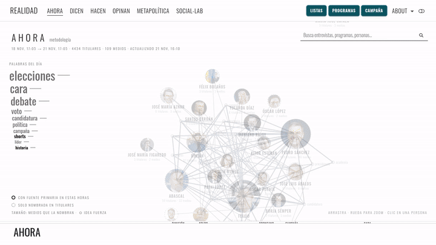

# realidad.eu · la hemeroteca abierta

Lo que dicen y hacen con **fuente primaria**.

> **El código completo se publicará aquí el 30 de noviembre de 2026**, el día después de las elecciones generales del 29-N. La web ya está abierta en [realidad.eu](https://realidad.eu).

## Qué es

Una hemeroteca pública y autoactualizable de fuentes primarias: qué dicen y qué hacen las personas públicas, los partidos y los medios, contrastado con datos oficiales y siempre en relativo (euros constantes, por habitante, % del PIB) y con su tendencia.

- **AHORA:** lo más dicho y lo más citado en los medios.
- **DICEN:** entrevistas, debates y mítines transcritos al minuto, con cada dato contrastado con su fuente.
- **HACEN:** trayectorias con datos públicos y abiertos.
- **OPINAN:** quién escribe de quién.
- **METAPOLÍTICA:** análisis experimentales para entender dónde estamos.
- **SOCIAL-LAB:** lo más nombrado en redes y el SOCIESCORE, un análisis de los mensajes y las relaciones de un perfil.

## Qué se publicará

El paquete R, las migraciones de la base, las reglas públicas de clasificación y contraste (`modelo/`), los scripts de descarga, los textos de método y la web en Quarto.

**No se publicarán** la base de datos, las claves ni datos privados: cada persona que use el código construye su propia base en local y se hace cargo de sus claves.

## Licencias

Código: EUPL-1.2. Reglas, textos y datos propios: CC BY 4.0.

## Contacto

`contacto@realidad.eu`
